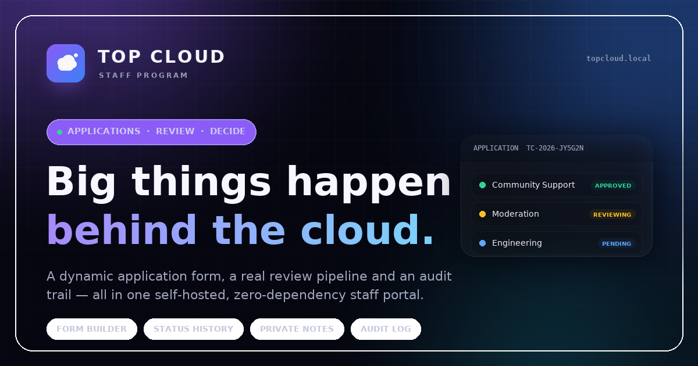

<p align="center">
  
</p>

<h1 align="center">Top Cloud</h1>

<p align="center">
  A complete, self-hosted staff application portal — dynamic application forms, a real review
  pipeline, status history, private reviewer notes, audit logging and a fully themed admin panel.
</p>

<p align="center">
  <strong>Next.js 15 · React 19 · TypeScript · Tailwind CSS 4 · libSQL/SQLite · Drizzle ORM · Zod · Argon2id</strong>
</p>

---

## Install in one command

Requirements: **Node.js 20.11+** (22 LTS recommended) on Linux or macOS. Nothing else — no database
server, no Docker, no external services. Windows is probably fine but was not verified in this
environment; use WSL if in doubt.

```bash
npm run topcloud
```

That single command:

1. creates `.env` with secure `600` permissions (and an **absolute** database path),
2. installs dependencies,
3. applies database migrations,
4. creates the owner (only if no owner exists), default settings and a starter form,
5. builds the production bundle,
6. verifies permissions, schema state and the "exactly one owner" invariant.

Then start the panel:

```bash
npm run start
```

Open <http://localhost:3000> for the public site, <http://localhost:3000/admin/login> for the panel.

### Why this is a "zero trust" install

- **One command, no services:** the database is a file created on your disk; nothing is provisioned
  or downloaded from anywhere except the npm registry.
- **Auditable:** the installer is `scripts/topcloud.mjs`, plain Node with no hidden steps. Read it
  before running it.
- **No telemetry, no callbacks, no accounts:** the app makes no outbound requests except SMTP when
  you configure it, and no phone-home code exists.
- **Idempotent and non-destructive:** re-running it never overwrites `.env`, never resets the owner,
  never replaces settings, and never touches existing applications. It checks the "exactly one
  owner" invariant and exits non-zero if a security check fails.
- **Local-first:** everything runs on one machine; nothing requires trusting a third party with your
  applicants' data.

### First login

| Field | Value |
| --- | --- |
| URL | `/admin/login` |
| Username | `admin` |
| Password | `admin` |
| New password | **you choose it — at least 10 characters** |

The seeded password is temporary. Every admin page and admin API is locked until it is replaced, and
the owner's password can never be reset back to a default by re-running the installer or the seed.

> ⚠️ **Before exposing the panel publicly, change the owner password.** The password change is forced
> on first login, but you should still do it before pointing a domain at the server.

### Common commands

| Command | What it does |
| --- | --- |
| `npm run start` | Production server on `0.0.0.0:3000` |
| `npm run dev` | Development server with hot reload |
| `npm test` | Full integration test suite (17 tests, isolated database) |
| `npm run typecheck` | TypeScript, no emit |
| `npm run build` | Production build |
| `npm run db:backup` | Consistent online backup into `data/backups/` |
| `npm run owner:recover` | Print a new temporary owner password (server access required) |
| `npm run db:migrate` | Apply pending migrations |
| `npm run topcloud -- --skip-build` | Install/repair without rebuilding |

---

## What's inside

### Public site
- Dark navy/black, purple-blue gradient design system with glass cards, animated glow, grid texture,
  scroll reveals and reduced-motion support.
- Live "applications open / paused" indicator driven by database settings.
- How-it-works timeline, team/role cards, security section, FAQ, footer.
- Branding (name, tagline, description, logo URL, accent gradient, support email, footer note) is
  stored in settings and editable from the admin panel with a live preview.
- `robots.txt` + `sitemap.xml` that never expose admin or member routes; Open Graph and Twitter cards.

### Members
| Route | Purpose |
| --- | --- |
| `/register` | Username, email, password — always creates a `MEMBER` |
| `/login` | Username **or** email |
| `/forgot-password`, `/reset-password` | Single-use, hashed reset tokens (1 hour) |
| `/verify-email` | Single-use verification tokens (24 hours) |
| `/dashboard` | Live status, next steps, profile completeness, quick links |
| `/apply` | Multi-step form generated from the published question set |
| `/my-applications` | Every submission with status badges |
| `/my-applications/:id` | Snapshotted answers, status timeline, published feedback |
| `/profile` | Change username/email, change password, verify email, sign out other sessions |

Members can read their own applications only. Ownership is enforced in the API layer
(`WHERE user_id = ?`), so a guessed UUID returns a flat `404`.

### Administration
| Route | Purpose |
| --- | --- |
| `/admin` | Live counts per status, recent applications, audit feed, pipeline chart |
| `/admin/applications` | Search by username / Discord / reference, status filter, sort, pagination |
| `/admin/applications/:id` | Full snapshot, applicant details, private notes, published feedback, status history |
| `/admin/questions` | Drag-free question builder (7 field types), drafts, publish, version history |
| `/admin/members` | Member directory, applications per member, roles, permissions, disable accounts |
| `/admin/settings` | Branding, positions, application rules, email notifications, audit log |
| `/admin/change-password` | Forced for temporary passwords; available at any time |

### Dynamic question builder
- Field types: short text, long text, email, number, dropdown, radio, checkboxes, yes/no.
- Per question: title, description, placeholder, required, options, order, enabled.
- Editing works on a **draft**. Publishing freezes a new immutable form version.
- Each submission stores a **snapshot** of the question wording, type, options and required flag it
  was answered against. Editing or republishing the form can never rewrite history.

### Statuses
`PENDING`, `REVIEWING`, `UNDER_CONSIDERATION`, `APPROVED`, `REJECTED`, `ON_HOLD`.

Every transition is written to `status_history` with the acting administrator, timestamp and note.
Members can see the timeline; only staff with `REVIEW_APPLICATIONS` can change it.

### Roles & permissions
| Role | Default abilities |
| --- | --- |
| `OWNER` | Everything, permanently. Sole owner, cannot be demoted, deleted or taken over |
| `ADMIN` | Only what the owner grants: review, questions, members, settings, audit |
| `MEMBER` | Own profile and own applications |

Membership registration always produces `MEMBER`. A role can only be granted by the owner, and
promotion to `ADMIN` requires the owner to choose permissions explicitly (empty permissions are
rejected) and forces a password change on next login.

### Audit log
Logins, failed logins, rate-limit blocks, registrations, application submissions, status changes,
notes, feedback, question edits/publishes, role changes, member disabling, settings changes, password
changes and owner recovery are recorded with actor, action, target, metadata, hashed IP and timestamp.
Passwords, hashes and tokens are never written to the log.

---

## Security

| Area | Implementation |
| --- | --- |
| Password storage | Argon2id (`@node-rs/argon2`, 19 MiB, t=2, p=1); hashes never leave the database |
| Sessions | 256-bit random token, SHA-256 stored server-side, `HttpOnly` `SameSite=Lax` cookie, `Secure` on HTTPS, 7-day sliding expiry |
| CSRF | Double-submit token (`tc_csrf` cookie + `x-csrf-token` header) on every mutation, plus same-origin `Origin` checks |
| Login throttling | 8 failed attempts per identifier and 30 per IP per 15 minutes, stored in the database and returned as `429` with `Retry-After` |
| Tokens | Verification (24 h) and reset (1 h) tokens are random, stored hashed, single-use, invalidated on password change |
| Input validation | Zod schemas on every route; 100 kB JSON body cap; strict question options and types |
| SQL injection | Parameterized Drizzle queries only |
| XSS | React escaping, no `dangerouslySetInnerHTML`; user-supplied URLs are rendered as text or via `` |
| Authorization | Server-side checks in every route and every page; member data scoped by `user_id` |
| Owner protection | Owner is seeded once; reinstalling never touches it; API rejects demoting/deleting/disabling the owner |
| Secrets | `.env` is git-ignored and created with `600`; database and backups are `600`; no secrets committed |
| Headers | `nosniff`, referrer policy, permissions policy, COOP, plus frame protection and HSTS in production |
| Errors | Safe API error codes; stack traces stay in server logs, never in HTTP responses |

Full checklist and threat notes: [`docs/SECURITY.md`](docs/SECURITY.md).

---

## Database

- **libSQL/SQLite** file at `data/topcloud.db` through `@libsql/client`, queried with Drizzle ORM.
- WAL mode, foreign keys on, busy timeout, synchronous NORMAL.
- 12 tables: users, sessions, auth_tokens, form_versions, questions, applications, answers,
  status_history, review_notes, audit_logs, settings, rate_limits.
- Migrations in `db/migrations/` are applied by `scripts/migrate.mjs` in a transaction, tracked with
  a SHA-256 checksum, and are safe to re-run.

### Backup

```bash
npm run db:backup
# → data/backups/topcloud-2026-10-18T18-22-04-123Z.db
```

Uses `VACUUM INTO`, so it is consistent even while the panel is live. Files are `600`.

### Restore

```bash
# 1. stop the server
# 2. replace the database
cp data/backups/topcloud-<timestamp>.db data/topcloud.db
chmod 600 data/topcloud.db
# 3. remove stale journals, then verify schema
rm -f data/topcloud.db-wal data/topcloud.db-shm
npm run db:migrate
# 4. start the server
npm run start
```

### Owner recovery

If the owner password is lost and SMTP is unavailable, someone with shell access to the server can
run:

```bash
npm run owner:recover
```

It prints a **new 24-character temporary password once**, forces a change on next login, revokes all
owner sessions and pending tokens, and writes an `OWNER_RECOVERY` audit entry. It never creates an
account or changes the owner's role. Treat shell access as root-equivalent access — that is inherent
to owning the server.

---

## Email (optional)

Verification, password-reset and status-change emails use SMTP (`nodemailer`). Without SMTP the app
still runs: email verification is not required by default, and password resets simply cannot be
delivered (use `npm run owner:recover` for the owner, or configure SMTP).

Set in `.env`:

```dotenv
SMTP_HOST="smtp.example.com"
SMTP_PORT="587"
SMTP_SECURE="false"          # true for implicit TLS on port 465
SMTP_USER="..."
SMTP_PASSWORD="..."
EMAIL_FROM="Top Cloud <no-reply@example.com>"
```

For **local development only**, `DEV_EMAIL_TOKENS="true"` prints one-time links to the server log.
It is ignored in production and must never be enabled on a public server.

---

## Environment variables

| Variable | Default | Notes |
| --- | --- | --- |
| `DATABASE_URL` | `file:./data/topcloud.db` | Installer rewrites this to an absolute path |
| `APP_URL` | `http://localhost:3000` | Public origin, no trailing slash; used for email links |
| `COOKIE_SECURE` | `false` | **Set `true` when serving over HTTPS** |
| `SESSION_TTL_DAYS` | `7` | 1–30 |
| `OWNER_USERNAME` | `admin` | Applied only when no owner exists |
| `OWNER_INITIAL_PASSWORD` | `admin` | Applied only when no owner exists; must change on first login |
| `OWNER_EMAIL` | `owner@topcloud.local` | Applied only when no owner exists |
| `SMTP_*`, `EMAIL_FROM` | empty | Optional email delivery |
| `DEV_EMAIL_TOKENS` | `false` | Local development only |

`.env.example` documents every variable. `.env` is never committed.

---

## Tests

```bash
npm test
```

Vitest runs against a **fresh, isolated** `data/topcloud-test.db` (deleted and re-seeded before each
run), so your real data is never touched. The suite exercises the real HTTP route handlers, cookies,
CSRF and the database.

Verified on 2026-10-18 in this repository:

```
Test Files  1 passed (1)
     Tests  17 passed (17)
  Duration  ~3.9 s
```

Coverage (17 tests, including all 15 required scenarios):

1. Exactly one owner seeded, Argon2id hash, `OWNER_BOOTSTRAP` audit entry
2. Forced password change blocks the admin panel and admin APIs until completed
3. Re-running the seed preserves the owner and password hash (no reset on redeploy)
4. Registration, login, session and logout for members
5. A member can submit an application and read their own frozen snapshot
6. A member cannot read another member's application (`404`)
7. A member cannot change their own application status
8. A member cannot manage questions
9. The owner can create, edit, reorder and publish form versions
10. An `ADMIN` with only `REVIEW_APPLICATIONS` can review but not manage questions or members
11. Status changes persist with actor attribution and full history
12. Internal notes never appear in member responses; published feedback does
13. Unauthorized role changes are rejected; the owner account is protected
14. Historical applications survive form republishing unchanged
15. Audit trail exists and is restricted to permitted administrators
16. Repeated failed logins are rate limited (`429`)
17. CSRF and cross-origin mutations are rejected without invalidating the session

Also verified: `npx tsc --noEmit` exits `0`, `npm run build` exits `0`, the one-command installer
completes on this repository, and a browser smoke test covered the landing page, registration,
member dashboard, application submission, review pages and the full admin panel in both development
and production builds.

> The tests hit the Next.js route handlers directly; they do not start a browser. Visual behaviour is
> covered by the manual smoke test described above.

---

## Architecture

```
src/
  app/
    page.tsx                 landing page
    (auth)/                  login, register, forgot/reset password, verify email
    (member)/                dashboard, apply, my-applications, profile
    admin/login/             isolated admin sign-in
    admin/(panel)/           dashboard, applications, questions, members, settings
    api/                     REST route handlers (Zod + session + CSRF + rate limits)
  components/
    ui/                      design-system primitives
    public/, auth/, member/, admin/
  lib/
    session, tokens, rate-limit, audit, permissions, settings, form,
    applications, email, validation, api, request, page-auth
  db/
    schema.ts                Drizzle schema (12 tables)
    index.ts                 libSQL client + PRAGMAs
db/migrations/               SQL migrations
scripts/                     installer, migrate, seed, backup, owner recovery
tests/                       Vitest integration suite
```

- Server components read the database directly with the session from cookies; mutations live in
  `/api/*` so they can be validated, rate-limited, CSRF-checked and audited consistently.
- Route handlers share `handle()` for uniform error mapping (`ApiError`, Zod `422`, unique `409`,
  SQLite busy `503`).
- Pages never trust client input for authorization: middleware is only a fast redirect, real checks
  happen in the page/route with the database.

---

## Deployment

See [`docs/DEPLOYMENT.md`](docs/DEPLOYMENT.md) for a production walkthrough: HTTPS with Caddy or
Nginx, systemd, `COOKIE_SECURE`, backups, upgrades and health checks.

Minimum production checklist:

- [ ] `APP_URL` set to the real HTTPS origin
- [ ] `COOKIE_SECURE="true"`
- [ ] Owner password changed, owner email set
- [ ] SMTP configured (or recovery via CLI accepted)
- [ ] `npm run build` before `npm start`
- [ ] Reverse proxy with TLS; keep `data/` on persistent storage
- [ ] Scheduled `npm run db:backup`
- [ ] `GET /api/health` monitored

---

## Honest limitations

- **Single-node SQLite.** Great for a staff panel, but it is one writer on one machine. Running
  multiple app instances against the same file over a network share is not supported. For horizontal
  scaling, move to a managed libSQL (Turso) or port the Drizzle schema to PostgreSQL.
- **Not load-tested.** The suite is functional/security integration testing, not a benchmark.
- **SMTP, HTTPS and reverse-proxy behaviour were not exercised in this environment** (no mail server,
  no public domain here). They are implemented and documented, but verify them on your host.
- **Email delivery is optional but not magic.** Without SMTP, members cannot receive verification or
  reset links; the owner recovery command remains available.
- **No CAPTCHA.** Abuse protection is rate limiting plus database constraints. Add a bot challenge at
  your reverse proxy if you expect targeted abuse.
- **Uploads are URLs, not files.** Branding accepts a logo URL; there is no file upload/storage layer.

---

## License

MIT — use it, brand it, ship it.
